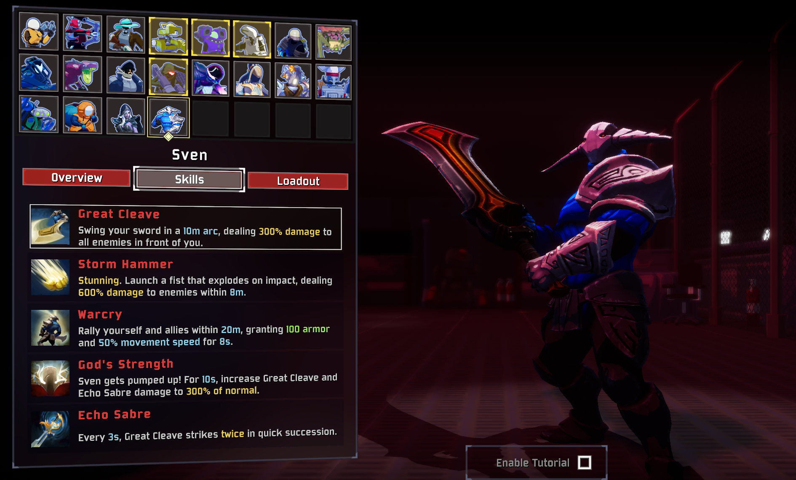
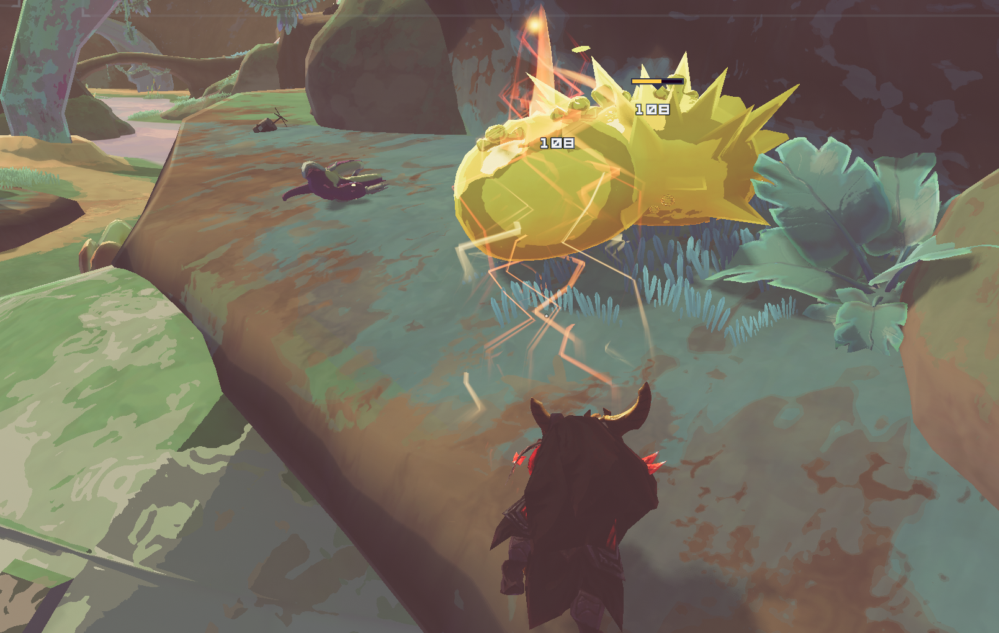
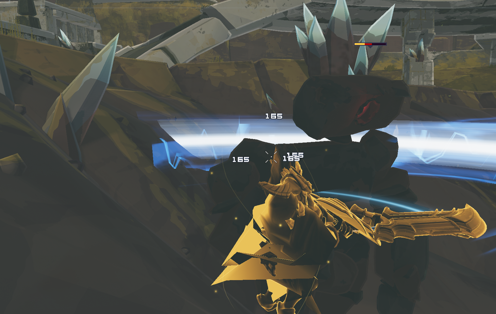
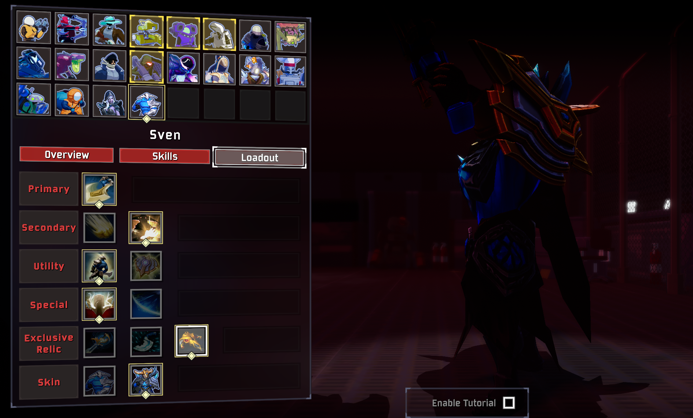

# Sven

Bring the Rogue Knight of Dota 2 to Petrichor V.

Sven is an armored melee survivor built around broad sword swings, decisive engagements, and overwhelming strength. Break up a crowd with Storm Hammer, rally your allies with Warcry, then unleash God's Strength or carry your momentum into two sweeping circular strikes.

[Thunderstore](https://thunderstore.io/c/riskofrain2/p/DDL/Sven/) · [GitHub](https://github.com/DDLovo/Sven) · [Report an issue](https://github.com/DDLovo/Sven/issues)

- Adds **Sven** as a separate playable survivor.
- Includes the classic appearance and **Vigil Triumph** cosmetic combination, with Dota-derived selection animations.
- Choose between **three exclusive relics** and alternate secondary, utility, and special skills.
- Features Dota-derived models, animations, icons, weapon sounds and Warcry yells, with effects adapted for Risk of Rain 2.
- Includes **English and Simplified Chinese** in-game text and optional **LookingGlass** proc information.

## Overview

Sven excels when enemies gather within reach. Great Cleave follows the direction of his swings, allowing each attack to catch several enemies. Storm Hammer provides a ranged opening; its Aghanim's Scepter variant takes Sven along for the ride, protected during flight.

Use Warcry to stay in the fight or help your team reposition. Choose God's Strength for sustained cleaving damage, or Momentum Cleave for a burst that rewards moving into the fight at speed. Falling also contributes to Heavy damage.

## Skills

Cooldowns are base values before item modifiers. Damage percentages are relative to Sven's damage stat.

| Slot | Skill | Description | Cooldown |
| --- | --- | --- | --- |
| Primary | **Great Cleave** | Swing your sword in a **10m arc** for **300% damage** to enemies in front of you. Attack speed shortens the swing. | — |
| Secondary | **Storm Hammer** | Launch a fist up to **80m**, exploding on impact for **600% damage** within **8m** and stunning eligible enemies for **1.75s**. | 8s |
| Secondary | **Storm Hammer: Aghanim's Scepter** | Fly forward up to **40m**, then explode for **300% damage** within **8m**, stunning eligible enemies. Sven is **invulnerable during flight** and cannot use other skills until the flight ends. | 10s |
| Utility | **Warcry** | Grant yourself and allies within **20m** **100 armor** and **50% movement speed** for **8s**. | 14s |
| Utility | **Warcry: Aghanim's Shard** | Grant yourself and allies within **20m** a **temporary barrier equal to 50% of maximum health**, plus **30% movement speed for 8s**. Barrier decays normally. | 14s |
| Special | **God's Strength** | **Sven gets pumped up!** After a committed windup, triple Great Cleave and Echo Sabre damage for **10s**. | 30s after the cast |
| Special | **Momentum Cleave** | **Heavy.** Sweep around yourself twice, dealing **2 × 1000% damage** within **20m**. Damage increases with movement speed. Each turn damages enemies as the blade passes, at most once per enemy per turn. | 7s |

Great Cleave follows your aim, including upward and downward angles. Momentum Cleave sweeps around Sven. Both have vertical reach to help with slopes and nearby airborne targets.

Damaging skills have a **1.0 proc coefficient per target per hit**. Control effects respect applicable native immunities. Momentum Cleave briefly retains landing speed and can be used after Aghanim flight ends.

## Exclusive Relics

Choose one relic in the loadout menu. Relics are passive choices and do not occupy your equipment slot.

| Relic | Effect |
| --- | --- |
| **Echo Sabre** | Every **3s**, your next Great Cleave triggers a fast extra swing for full damage, even if the first swing misses. A bright status icon shows readiness; a dark icon shows cooldown. |
| **Blink Dagger** | After **3s without taking damage**, using Warcry while sprinting also blinks up to **30m** toward your aim. Works with either Warcry variant. |
| **Black King Bar** | Using your special skill cleanses existing debuffs and damage over time, then grants **immunity to stuns, freezes, slows and knockback**: **6s** with God's Strength, or **2s** with Momentum Cleave. Does not prevent damage or allow casting while stunned or frozen. |

## Skins

**Sven** — The classic Rogue Knight, with his greatsword, heavy armor, and Dota selection presentation.

**Vigil Triumph / 守夜丰功** — Combines Vigil Signet, Vigil Triumph and Vigil Odyssey with the remaining Stormwrought Arbiter pieces. The sword opens during God's Strength, while Black King Bar enlarges Sven and gives his armor a golden appearance.

Both skins and all loadout choices are available immediately.

## Multiplayer and Configuration

**All players must have this mod enabled at the same version.** Sven is independent of DrowRanger and can be enabled or disabled separately. Multiplayer edge cases still need broader testing.

Sound volume is stored in `BepInEx/config/Sven.cfg`, created on first launch.

With **LookingGlass** installed, skill tooltips include proc coefficients. LookingGlass is optional. Its buff timer display can show the Echo Sabre countdown; the ready/cooldown icons also work without it.

## Feedback

When reporting an issue, include the mod version, selected skin and loadout, other installed mods, and whether you were hosting or joining. A short reproduction sequence and `BepInEx/LogOutput.log` are especially helpful. For animation or terrain issues, include a screenshot or short clip.

Feel free to [email me](mailto:ddlddl100086@gmail.com) or open a [GitHub issue](https://github.com/DDLovo/Sven/issues).

Also try [DrowRanger](https://thunderstore.io/c/riskofrain2/p/DDL/DrowRanger/), another Dota survivor by DDL.

## AI Disclosure

AI tools assisted with code, documentation, animation adaptation and some UI artwork. Gameplay design, review and in-game testing were directed by the author. The images above are actual gameplay screenshots, cropped for presentation. Dota character assets originate from Valve.

## Credits

- **DDL** — Mod author, gameplay design, testing and Chinese text.
- **Valve / Dota 2** — Sven, cosmetic assets, animations, source effects, icons and audio; Juggernaut's Blade Fury source animation used for the adapted double spin.
- **HenryTutorial contributors** — Survivor template and project foundation.
- **BepInEx and R2API contributors** — Mod loading and survivor integration tools.
- **ValveResourceFormat / Source 2 Viewer and Blender contributors** — Asset inspection, extraction and conversion tools.

This is a community-made adaptation of Sven for Risk of Rain 2. Character assets belong to their respective creators. Source 2 effects are adapted for Unity.
